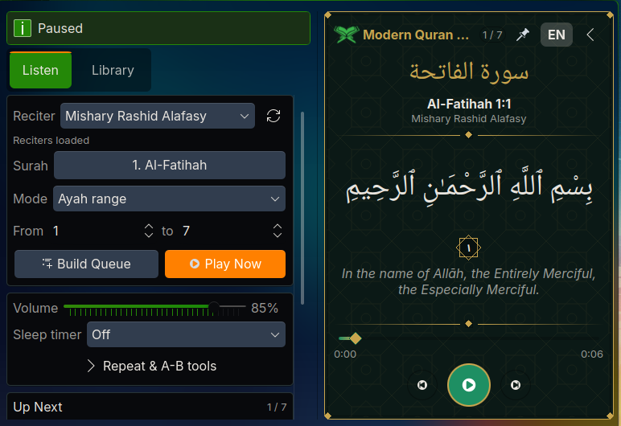

# ☪ Modern Quran Player - KDE plasma Widget

**A modern Quran listening experience for KDE Plasma 6.**

Modern Quran Player is a feature-rich Plasma widget designed to bring Quran audio playback directly to your KDE desktop. It combines an elegant Islamic-inspired interface with flexible playback controls, reciter selection, queue management, bookmarks and listening progress tracking.

The widget features a dedicated listening panel alongside a beautifully designed Quran player, with Arabic Ayah display, optional English translation and convenient playback controls.

## 📸 Screenshots

### Main Quran Player


### Listening Panel


## ✨ Features

### 🎧 Quran Audio Player
- Play individual Ayahs or complete Surahs.
- Select specific Ayah ranges.
- Choose from multiple Quran reciters.
- Play immediately or build a playback queue.
- Previous, next, pause and resume controls.
- Adjustable playback volume.
- Automatic playback progression through the queue.
- Restore the previous listening session.

### 📖 Reciters & Quran Library
- Curated selection of 10 reciters.
- Browse and select from available reciters.
- Refresh the reciter list.
- Quick-start playback options.
- Browse all 114 Surahs.
- Save custom playback presets.
- Bookmark your listening positions.

### 🔁 Advanced Playback Tools
- Repeat playback controls.
- Ayah repetition.
- A–B loop functionality.
- Sleep timer.
- Queue management.
- Remove individual tracks from the queue.

### 📚 Listening Progress
- Khatm progress tracking.
- Track completed Surahs.
- View listening progress.
- Save and reuse playback configurations.
- Manage bookmarks and saved presets.

### 🌍 Arabic & English Display
- Beautiful Arabic Quranic text.
- Optional English translation.
- Surah name and Ayah number display.
- English translation from Saheeh International.
- Language toggle directly from the player.

### 🖥️ KDE Plasma Integration
- Designed for KDE Plasma 6.
- Compact panel representation.
- Expanded player popup.
- Optional listening and library side panel.
- Pin the popup to keep it open.
- Animated equalizer indicator while playing.
- Playback configuration and appearance settings.
- Media playback integration through MPRIS.

## 🎨 Interface

Modern Quran Player includes two main areas:

**1. Listening Panel**
- Listen and Library tabs.
- Reciter and Surah selection.
- Ayah range configuration.
- Queue builder.
- Volume and sleep timer controls.
- Repeat and A–B playback tools.

**2. Quran Player**
- Arabic Surah title.
- Current Ayah in Arabic.
- Optional English translation.
- Reciter information.
- Playback progress.
- Previous, play/pause and next controls.

The interface uses a dark emerald palette, elegant geometric Islamic patterns and gold decorative accents.

## 📦 Installation

### Install using the Plasmoid package

Download the latest `.plasmoid` package from the GitHub Releases section.

Install using the terminal:

```bash
kpackagetool6 --type Plasma/Applet --install modernquranplayer.plasmoid
```

Then add **Modern Quran Player** to your Plasma desktop or panel.

### Remove

```bash
kpackagetool6 --type Plasma/Applet --remove com.modernquranplayer
```

## 🌐 Online Services

The widget uses online services for Quran audio and text:

- Quran.com API for Quran data and translations.
- EveryAyah for curated reciter audio.
- Quran.com audio services for available reciter data.

An internet connection is required for online audio and translation retrieval.

## 🛠️ Technologies

- Qt Quick / QML
- JavaScript
- KDE Plasma 6
- KDE Kirigami
- Qt Multimedia
- MPRIS media integration
- Local storage for settings, bookmarks, presets and progress.

## 📋 Compatibility

- KDE Plasma 6
- Minimum Plasma version: 6.0

## 🙏 Credits

Inspired by the original Quran Player project by **muhyo**.

Thanks to the Quran.com and EveryAyah services for providing Quran data and audio resources.

## 📄 License

Apache License 2.0.

---
## 🔗 Original Project

This project is a fork of the original Quran Player:

- **Original author:**  (https://github.com/mymuhyo)
- **Original repository:** [Original GitHub Repository](https://github.com/mymuhyo/kde-widget-quran)

This fork builds upon the original project with additional features,
improvements and a redesigned interface.

**Modern Quran Player — Bring Quran listening to your KDE desktop.**
